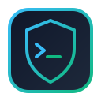
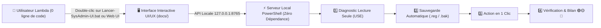

<div align="center">
  
  <h1>🛡️ Senior SysAdmin (Windows & Linux 10+ YoE) & DevSecOps</h1>
  <p><strong>Outil Interactif Grand Public (UI/UX) + Plugin & Sous-Agent Autonome pour Google Antigravity</strong></p>
  <p><em>« Expert sous le capot, Simple à l'écran » — utilisable par tout le monde en 1 clic, sans aucune compétence technique requise</em></p>

  <p>
    <a href="https://boris13-tech.github.io/sysadmin-devsecops-senior-agent/">
      
    </a>
    &nbsp;
    <a href="https://github.com/Boris13-tech/sysadmin-devsecops-senior-agent/releases/latest/download/SysAdmin-DevSecOps-Senior-Tool-v1.0.0.zip">
      
    </a>
  </p>
</div>

---

## 🌟 2 Modes d'Utilisation pour un Utilisateur Lambda (Débutant)

### 1️⃣ Utiliser l'Application En Ligne (Sans rien installer)
👉 **[Cliquez ici pour ouvrir le Centre de Contrôle Interactif en ligne](https://boris13-tech.github.io/sysadmin-devsecops-senior-agent/)**
- Explorez le tableau de bord visuel (Score de santé sur 100, jauges Mémoire RAM, Disques, Bouclier de sécurité).
- Utilisez l'**Assistant Interactif « Docteur Système »** en cliquant simplement sur ce que vous ressentez (*"🐢 Mon PC est lent"*, *"💾 Mon disque est plein"*, *"🛡️ Vérifier ma sécurité"*, *"🌍 Internet bloque"*).
- Importez ou exportez un bilan JSON en 1 clic.

### 2️⃣ Télécharger l'Outil sur votre PC (Action en Direct en 1 Clic)
👉 **[Téléchargez `SysAdmin-DevSecOps-Senior-Tool-v1.0.0.zip` (Release Officielle)](https://github.com/Boris13-tech/sysadmin-devsecops-senior-agent/releases/latest/download/SysAdmin-DevSecOps-Senior-Tool-v1.0.0.zip)**
1. **Extrayez le fichier `.ZIP`** sur votre Bureau ou dans vos Téléchargements.
2. **Double-cliquez sur `Lancer-SysAdmin-UI.bat`** (sous Windows) ou `lancer-sysadmin-ui.sh` (sous Linux).
3. L'interface graphique s'ouvre toute seule dans votre navigateur avec le badge **🟢 Connecté en Direct à votre PC** :
   - **🔍 Diagnostic Complet en 1 clic** (CPU, RAM, Disques, Pare-feu, Antivirus, Ports ouverts traduits en français simple).
   - **🚀 Alléger le Démarrage Windows en 1 clic** (sauvegarde automatique du Registre `.reg` + désactivation des logiciels lourds au démarrage).
   - **🧹 Nettoyer les Fichiers Inutiles en 1 clic** (sans jamais toucher à vos documents personnels).
   - **🌐 Réparer Internet / Vider le Cache DNS en 1 clic**.
   - **⏪ Bouton d'Annulation (Rollback 1-Clic)** pour revenir à l'état exact précédent à tout moment.

---

## 🏗️ Architecture & Protocole Senior D.S.A.V.



---

## 📦 Structure Complète du Dépôt

```text
sysadmin-devsecops-senior-agent/
├── Lancer-SysAdmin-UI.bat                          # 🖱️ Double-clic Windows : lance l'interface graphique connectée au PC
├── lancer-sysadmin-ui.sh                           # 🐧 Lanceur de l'interface graphique pour Linux / macOS
├── docs/                                           # 🌐 Application Web Interactive (GitHub Pages & UI Locale)
│   ├── index.html                                  # Tableau de bord visuel & Assistant « Docteur Système »
│   ├── styles.css                                  # Design moderne Dark Glassmorphism
│   └── app.js                                      # Logique interactive (Mode En Ligne + Mode Connecté au PC)
├── server/
│   └── start-ui-server.ps1                         # Serveur HTTP local natif PowerShell (Zéro dépendance à installer)
├── plugin.json                                     # Manifeste du plugin Google Antigravity
├── install.ps1 / install.sh                        # Installateurs 1-clic du plugin pour Google Antigravity
├── agents/
│   └── sysadmin_devsecops_senior.md                # Sous-agent spécialisé Senior SysAdmin & DevSecOps
├── rules/
│   └── AGENTS.md                                   # Règles d'or D.S.A.V. & pédagogie sans jargon
└── skills/
    ├── windows-sysadmin-senior/                    # Audit santé, nettoyage Temp/DNS, optimisation démarrage + Rollback
    ├── linux-sysadmin-senior/                      # Audit Linux/WSL (Méthode USE : CPU, RAM, Disques, Inodes, systemd)
    └── devsecops-hardening-audit/                  # Audit sécurité CIS (Pare-feu, Defender, UAC, RDP, Ports exposés)
```

---

## 🤖 Utilisation comme Plugin dans Google Antigravity

Si vous utilisez **Google Antigravity**, vous pouvez également installer cet agent directement dans votre IDE :

```powershell
powershell -ExecutionPolicy Bypass -File .\install.ps1
```

---

## 📜 Licence

Distribué sous licence **MIT**. Créé pour **Boris Owandja (@Boris13-tech)**.
