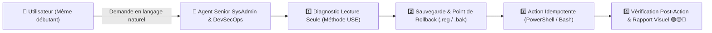

<div align="center">
  
  <h1>🛡️ Senior SysAdmin (Windows & Linux 10+ YoE) & DevSecOps Agent</h1>
  <p><strong>Plugin & Sous-Agent Autonome pour Google Antigravity — « Expert sous le capot, Simple à l'écran »</strong></p>
</div>

---

## 🎯 Objectif du Projet

Ce dépôt fournit un **Plugin complet, un Sous-Agent spécialisé (`sysadmin_devsecops_senior`), des Règles Opérationnelles (`AGENTS.md`) et des Scripts d'Audit/Remédiation (PowerShell & Bash)** qui transforment **Google Antigravity** en un **Administrateur Système Senior (Windows & Linux, 10+ ans d'expérience)** et **Architecte DevSecOps**.

Conçu pour être **100 % accessible à un débutant** tout en appliquant la rigueur d'un ingénieur senior en production :
- 🧠 **Zéro jargon non expliqué** : Chaque diagnostic est traduit en langage clair avec un tableau visuel (`🟢 OK`, `🟡 Attention`, `🔴 Critique`).
- ⚡ **Mode "Fais-le pour moi"** : L'agent exécute lui-même les diagnostics et les réparations sans demander à l'utilisateur de taper des commandes complexes.
- 🛡️ **Protocole D.S.A.V.** (*Diagnostic → Sauvegarde → Action → Vérification*) : Aucune modification du système ou du Registre n'est appliquée sans sauvegarde préalable (`.reg` / `.bak`) et commande d'annulation (*Rollback*) prête à l'emploi.

---

## 🏗️ Architecture du Plugin & Flux D.S.A.V.



---

## 📦 Structure du Dépôt

```text
sysadmin-devsecops-senior-agent/
├── plugin.json                                     # Manifeste du plugin Antigravity
├── install.ps1                                     # Installateur 1-clic Windows (PowerShell)
├── install.sh                                      # Installateur 1-clic Linux / macOS / WSL
├── agents/
│   └── sysadmin_devsecops_senior.md                # Définition du sous-agent spécialisé
├── rules/
│   └── AGENTS.md                                   # Règles d'or D.S.A.V. & pédagogie débutant
├── skills/
│   ├── windows-sysadmin-senior/
│   │   ├── SKILL.md                                # Runbooks Windows Client & Server (AD, GPO, DISM, SFC)
│   │   └── scripts/
│   │       ├── win-health-audit.ps1                # Audit complet CPU/RAM/Disques/Services/EventLogs
│   │       ├── win-quick-repair.ps1                # Nettoyage sécurisé Temp & vidage cache DNS
│   │       └── win-startup-optimize.ps1            # Optimisation démarrage avec export Registre (.reg)
│   ├── linux-sysadmin-senior/
│   │   ├── SKILL.md                                # Runbooks Linux (systemd, LVM/ZFS, sysctl, SSH)
│   │   └── scripts/
│   │       └── linux-health-audit.sh               # Audit complet Linux / WSL (Méthode USE)
│   └── devsecops-hardening-audit/
│       ├── SKILL.md                                # Hardening CIS, Docker/K8s, CI/CD & Forensique REA
│       └── scripts/
│           └── win-security-audit.ps1              # Audit Pare-feu, Defender, UAC, RDP, Ports exposés
└── .github/workflows/
    └── ci.yml                                      # Pipeline CI DevSecOps (Validation JSON, PowerShell & Bash)
```

---

## 🚀 Installation en 1 Clic

### Sur Windows (PowerShell)
```powershell
git clone https://github.com/Boris13-tech/sysadmin-devsecops-senior-agent.git
cd sysadmin-devsecops-senior-agent
powershell -ExecutionPolicy Bypass -File .\install.ps1
```

### Sur Linux / macOS / WSL (Bash)
```bash
git clone https://github.com/Boris13-tech/sysadmin-devsecops-senior-agent.git
cd sysadmin-devsecops-senior-agent
bash ./install.sh
```

---

## 🛠️ Exemples d'Utilisation directe des Scripts

### 1. Audit de Santé Windows (JSON)
```powershell
powershell -NoProfile -ExecutionPolicy Bypass -File .\skills\windows-sysadmin-senior\scripts\win-health-audit.ps1
```

### 2. Audit de Sécurité & Hardening CIS Windows
```powershell
powershell -NoProfile -ExecutionPolicy Bypass -File .\skills\devsecops-hardening-audit\scripts\win-security-audit.ps1
```

### 3. Optimisation Sécurisée du Démarrage Windows (avec Rollback automatique)
```powershell
# Optimiser (crée automatiquement une sauvegarde .reg dans ~/.gemini/Backups/SysAdmin/)
powershell -NoProfile -ExecutionPolicy Bypass -File .\skills\windows-sysadmin-senior\scripts\win-startup-optimize.ps1

# Annuler et restaurer l'état exact précédent (Rollback en 1 clic)
powershell -NoProfile -ExecutionPolicy Bypass -File .\skills\windows-sysadmin-senior\scripts\win-startup-optimize.ps1 -RestoreLatest
```

---

## 📜 Licence

Distribué sous licence **MIT**. Créé pour **Boris Owandja (@Boris13-tech)**.
